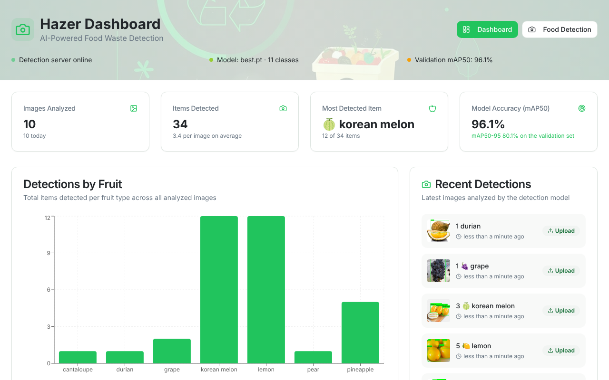
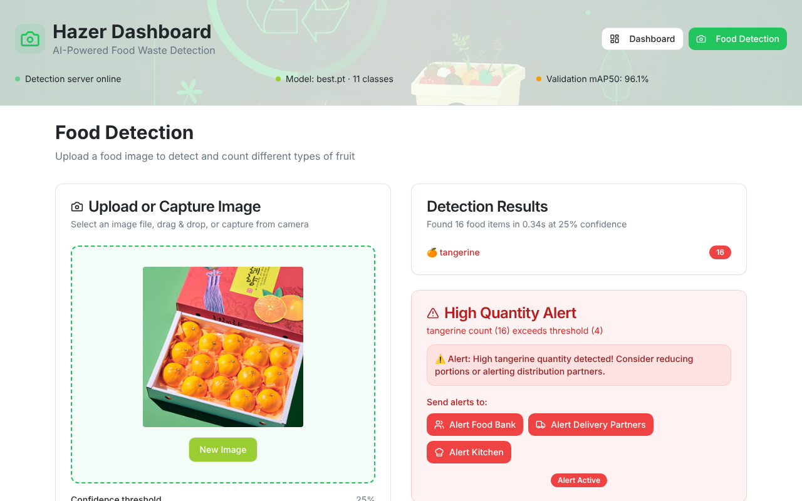

# Hazer - AI-Powered Food Waste Detection System

Hazer detects and counts fruit in photos with a custom-trained YOLOv8 model, then shows the results on a dashboard. You can upload an image, drag and drop one, or take a photo with your webcam. Every analysis is saved, and the dashboard charts what has been detected.


**Model:** YOLOv8s fine-tuned on 11 fruit classes. On the validation set it scores **96.1% mAP50** and **80.1% mAP50-95** (precision 90.8%, recall 91.1%, best of 50 epochs). On CPU, inference takes about 0.1 s per image.

## Features

### Real (backed by the model)
- **Fruit detection**: bounding boxes, per-class counts and confidence scores for apple, tangerine, pear, watermelon, durian, lemon, grape, pineapple, dragon fruit, korean melon and cantaloupe.
- **Three ways to add an image**: file upload, drag and drop, or live camera capture. Camera photos are kept in `backend/camera_captures/`.
- **Adjustable confidence threshold**: a slider sets how confident the model must be, and you can re-analyze the same image at a new threshold.
- **Dashboard from real history**: every analysis is stored in SQLite. The dashboard shows images analyzed, items detected, the most detected fruit, a per-fruit chart, recent detections with thumbnails, and the model's real validation mAP read from its training results.
- **Live server status**: the header shows whether the detection server is online and which model it loaded. If the trained model is missing, you get a warning instead of silently wrong labels.
- **High-quantity alerts**: when a fruit's count passes its threshold, an alert card appears.

### Demo only (clearly labelled "Demo data" in the UI)
- **UAE network map**: 12 fictional locations showing how multi-site monitoring would look.
- **Waste reduction insights and action items**: sample content.
- **Alert notifications and the impact screen**: simulated. No real notifications are sent.

| Dashboard | Detection |
| --- | --- |
|  |  |

## Architecture

```
React + TypeScript (Vite)  ──/api proxy──▶  Flask API  ──▶  YOLOv8 (Ultralytics)
   Dashboard, Food Detection                  │
                                              ├─ SQLite history (backend/history.db)
                                              ├─ annotated/ and camera_captures/ (newest 200 kept)
                                              └─ training metrics from runs/detect/*/results.csv
```

## Tech Stack

- **Frontend:** React 18, TypeScript, Vite, Tailwind CSS, shadcn/ui, TanStack Query, Recharts, React Router
- **Backend:** Python 3.9+, Flask, Ultralytics YOLOv8, OpenCV, SQLite
- **Training:** Ultralytics YOLOv8s, fruit object detection dataset (Roboflow / DatasetNinja)

## Getting Started

### Quick start (Windows)

Run `start.bat`. It creates a virtual environment, installs the backend requirements, downloads the trained model, then starts both servers. Setup re-runs automatically whenever `backend/requirements.txt` changes.

### Manual setup

```bash
# Backend
cd backend
python -m venv venv
venv\Scripts\activate            # macOS/Linux: source venv/bin/activate
python setup.py                  # installs requirements and downloads models/best.pt
python app.py                    # http://localhost:5000

# Frontend (in a second terminal, from the project root)
npm install
npm run dev                      # http://localhost:8080
```

`setup.py` downloads the trained weights from this repository's [latest release](https://github.com/KDaqrouq/waste-wise-hazer/releases/latest). Without them, the server falls back to the stock COCO `yolov8n` model, and the app shows a warning because those labels aren't fruit.

### Configuration

All settings are environment variables and are optional.

| Variable | Default | What it does |
| --- | --- | --- |
| `HAZER_HOST` | `127.0.0.1` | Interface the API listens on. Set `0.0.0.0` only if other devices need to reach it. |
| `HAZER_PORT` | `5000` | API port |
| `FLASK_DEBUG` | off | Set to `1` to turn on the Flask debugger. Never combine this with `HAZER_HOST=0.0.0.0`. |
| `HAZER_MODEL_PATH` | `backend/models/best.pt` | Weights to load |
| `HAZER_MAX_UPLOAD_MB` | `10` | Largest image accepted |
| `HAZER_MAX_SAVED_IMAGES` | `200` | How many annotated images and camera captures to keep |
| `HAZER_MODEL_URL` | latest GitHub release | Where `setup.py` downloads the model from |

## API

| Method | Endpoint | Description |
| --- | --- | --- |
| `POST` | `/api/predict` | Detect fruit in an uploaded image. Form fields: `image` (file), optional `conf` (0.05 to 0.95, default 0.25). |
| `POST` | `/api/camera-capture` | Same as above, and also keeps the original photo in `camera_captures/` |
| `GET` | `/api/health` | Server status plus model info (source, classes, validation metrics) |
| `GET` | `/api/classes` | Class names the loaded model knows |
| `GET` | `/api/history?limit=10` | Most recent analyses |
| `GET` | `/api/history/<id>/image` | Annotated image for one analysis |
| `GET` | `/api/stats` | Totals, per-class counts, the last 7 days and model info, used by the dashboard |

Errors come back as `{"success": false, "error": "..."}` with a 4xx or 5xx status, and the frontend shows the message.

## Training Your Own Model

```bash
cd backend
python train_model.py              # resume the latest unfinished run, or start a new one
python train_model.py --fresh      # start a new run from yolov8s.pt
python train_model.py --epochs 75  # epochs for a new run (also used to fine-tune a finished run)
```

The script asks for Roboflow credentials only if `datasets/fruit-object-detection/data.yaml` is missing. Runs are saved to `backend/runs/detect/fruit-detection*/`. When training finishes, the best weights are copied to `backend/models/best.pt`, and the API reads that run's `results.csv` to report mAP.

To measure inference speed, run `python backend/benchmark_inference.py [image]`.

## Tests

```bash
cd backend
pip install -r requirements-dev.txt
pytest
```

The tests use a stand-in model, so they run in about a second without weights. They cover detection responses, the confidence threshold, invalid uploads, upload size limits, path-traversal-safe file names, image cleanup, history and stats.

## Project Structure

```
waste-wise-hazer/
├── src/
│   ├── components/          # Header, charts, recent detections, camera, alerts, demo map
│   ├── hooks/use-backend.ts # Shared React Query hooks for health, stats and history
│   ├── lib/api.ts           # Typed API client with readable error messages
│   └── pages/               # Index (dashboard), FoodDetection
├── backend/
│   ├── app.py               # Flask API
│   ├── db.py                # SQLite detection history
│   ├── run_utils.py         # Find training runs and read their metrics
│   ├── train_model.py       # Training pipeline
│   ├── benchmark_inference.py
│   ├── setup.py             # Install requirements, download the model
│   └── tests/               # pytest suite
├── docs/                    # README screenshots and demo GIF
└── start.bat                # One-click start on Windows
```

## Troubleshooting

- **"Can't reach the detection server"**: the Flask API isn't running. Start it with `python app.py` in `backend/`.
- **Labels like "person" or warnings about a generic model**: `backend/models/best.pt` is missing. Run `python setup.py`.
- **"Image is too large"**: raise `HAZER_MAX_UPLOAD_MB` or resize the image.
- **CUDA/GPU**: the default PyTorch install runs on CPU. For GPU training, install a CUDA build of PyTorch.
